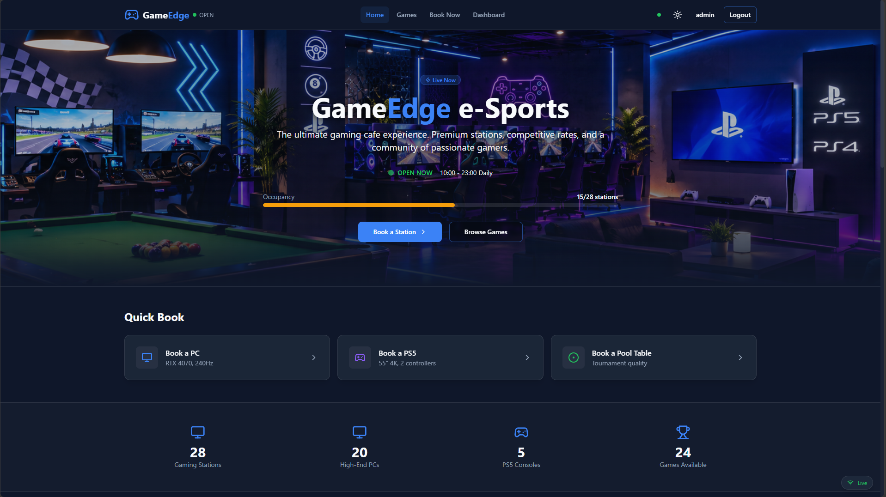
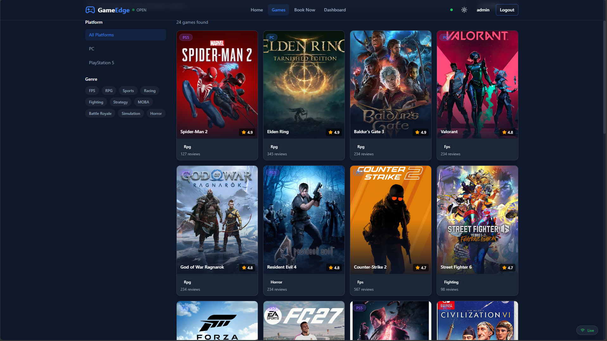
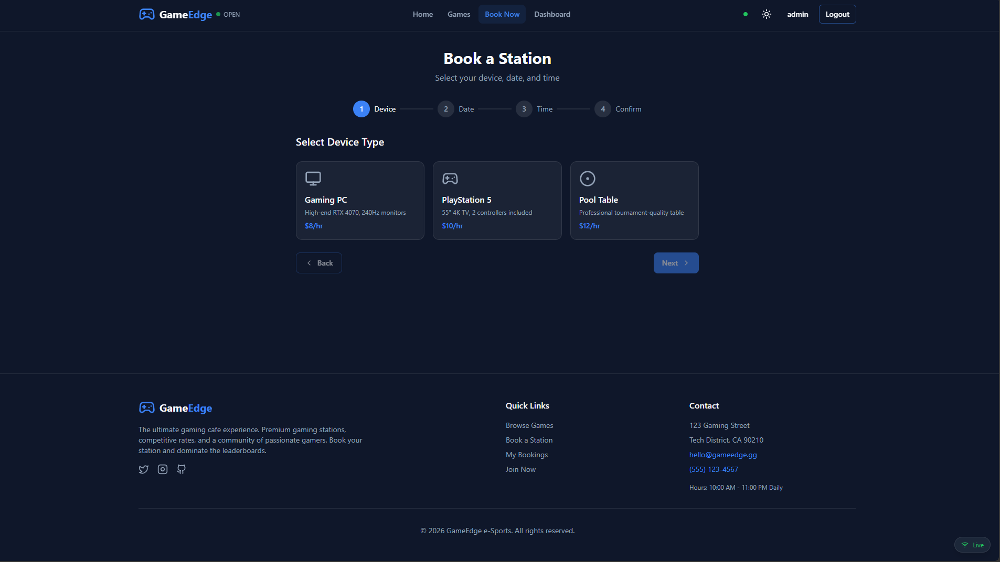

# 🎮 GameEdge e-Sports

A full-stack gaming cafe platform where players can browse the game library, check live cafe status and book PCs, PS5 consoles and pool tables online.

Built as an npm workspaces monorepo with a TypeScript backend API, a shared types package and a Next.js client.

## ✨ Features

- **Home page**: live cafe open/closed status, occupancy bar, pricing & rates, featured games
- **Game library**: search, platform filter (PC / PS5), genre filter, sorting (rating, name, reviews)
- **Game detail page**: cover art, rating, developer, reviews, related games
- **Booking flow**: 4 steps (device, date, time slot, confirmation)
- **User dashboard**: booking history, active booking, quick re-book
- **Authentication**: login / register with role-based accounts (admin, staff, customer)
- **Real-time updates**: WebSocket server for live cafe status
- **Auto seed data**: users, devices, time slots, games and POS items are created on first run

## 🧰 Tech Stack

| Layer | Technology |
|---|---|
| Client | Next.js 14, React, TypeScript, Tailwind CSS, Framer Motion, Lucide icons |
| Server | Node.js, TypeScript (tsx), REST API, WebSocket (`/ws`), bcrypt |
| Shared | Shared TypeScript types / utilities (`packages/shared`) |
| Tooling | npm workspaces, EditorConfig |

## 📁 Project Structure

```
GameEdge/
├── packages/
│   ├── client/    # Next.js frontend (port 3000)
│   ├── server/    # Backend API + WebSocket (port 3001)
│   └── shared/    # Shared types and utilities
├── package.json   # npm workspaces root
└── tsconfig.base.json
```

## 🚀 Getting Started

### Prerequisites

- [Node.js](https://nodejs.org) 18 or 20 (LTS)
- npm
- Git

### 1. Clone and install

```bash
git clone https://github.com/Kavinduuuuu/GameEdge.git
cd GameEdge
npm install
```

### 2. Configure environment variables

```bash
# macOS / Linux
cp packages/server/.env.example packages/server/.env

# Windows (PowerShell)
copy packages\server\.env.example packages\server\.env
```

Open `packages/server/.env` and fill in the values.

### 3. Run the backend

```bash
npm run dev -w packages/server
```

The API runs on `http://localhost:3001`.
Health check: `http://localhost:3001/api/health`

On the first run the database is empty, so the seed script runs automatically.

### 4. Run the client (new terminal)

```bash
npm run dev -w packages/client
```

Open `http://localhost:3000`.

> **Note:** run both terminals from the repository root (`GameEdge/`).

## 🔑 Demo Accounts (seed data)

| Role | Email | Password |
|---|---|---|
| Staff | `carlos@gameedge.com` | `staff123!` |
| Customer | `alex@email.com` | `customer123!` |
| Customer | `maria@email.com` | `customer123!` |

Admin and other accounts are listed in `packages/server/src/db/seed.ts`.
These are demo credentials for local development only.

## 💰 Pricing (Rs.)

| Station | Rates |
|---|---|
| Gaming PC | 1 hour Rs. 400 · 5 hours Rs. 1,750 |
| PS5 | 1 player Rs. 800 · 2 players Rs. 1,200 · 3 players Rs. 1,600 · 4 players Rs. 2,000 |
| PS4 | 1 player Rs. 500 · 2 players Rs. 800 · 3 players Rs. 1,000 · 4 players Rs. 1,200 |
| Racing Simulator | 30 min Rs. 500 · 1 hour Rs. 1,000 |
| Pool Table | 1 hour Rs. 1,000 |

## 📸 Screenshots

### Home


### Game Library


### Booking


## 🛠️ Useful Scripts

| Command | Description |
|---|---|
| `npm install` | Install all workspace dependencies (run in the root) |
| `npm run dev -w packages/server` | Start the backend in watch mode |
| `npm run dev -w packages/client` | Start the Next.js dev server |

## 🗺️ Roadmap

- [ ] Connect the game library and detail pages to the backend API
- [ ] Real reviews per game
- [ ] Booking support for PS4 and Racing Simulator
- [ ] Admin / staff dashboards
- [ ] Deployment

## 📝 Notes

- Game cover art and trademarks belong to their respective owners and are used for demonstration purposes only.
- This is a student / portfolio project.

## 👤 Author

**Kavindu**: BSc (Hons) Information Technology, Horizon Campus

GitHub: [@Kavinduuuuu](https://github.com/Kavinduuuuu)